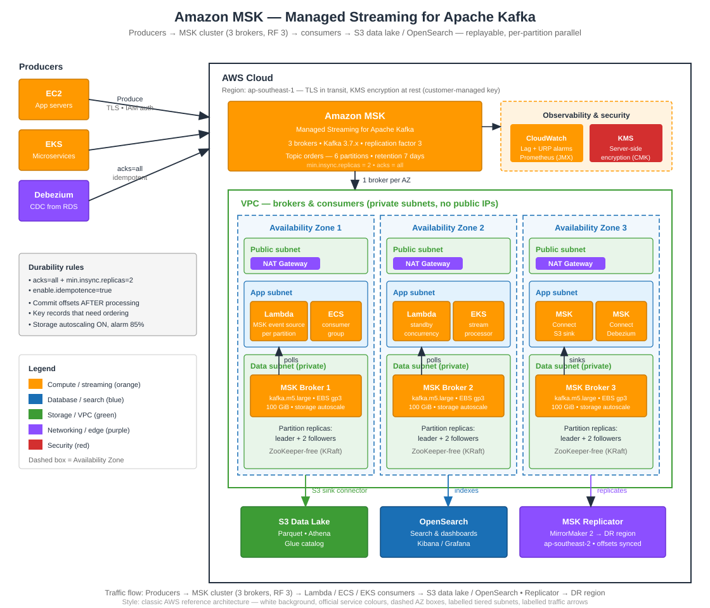

# Amazon MSK — Managed Kafka Done Right


> **TL;DR:** Amazon MSK gives you real Apache Kafka without the 3 a.m. pager duty for ZooKeeper, broker patching, and disk-full incidents. Pick provisioned brokers when throughput is predictable, MSK Serverless when it isn't — and set `acks=all` with `min.insync.replicas=2`, or your "durable" log isn't durable at all.

---

## What This Guide Covers

- Provisioned vs Serverless vs Express brokers — which one, and when
- Topics, partitions, and replication: the sizing math that decides your throughput
- Producer durability (`acks=all`, idempotence, transactions) and exactly-once semantics
- Consumer groups, rebalancing, and offset management that doesn't lose data
- Authentication (IAM, SCRAM, mTLS) and encryption (TLS + KMS)
- MSK Connect and MSK Replicator (MirrorMaker 2) for pipelines and cross-region DR
- Monitoring with CloudWatch + Prometheus open monitoring, and the alarms that matter
- Cost levers and the mistakes that turn a Kafka cluster into a money fire

---

## Architecture



**Flow:** Producers (EC2 / ECS / EKS apps, Debezium CDC) → **MSK cluster** (3 brokers, one per AZ, replication factor 3, topics partitioned for parallel reads) → **Consumers** (Lambda via MSK event source, ECS/EKS workers, MSK Connect sink connectors) → **S3 data lake** (Parquet via the S3 sink connector) and **OpenSearch** for search. **MSK Replicator** mirrors topics to a second region for DR. **CloudWatch + Prometheus** watch lag and under-replicated partitions; **KMS** encrypts data at rest; **IAM / SCRAM / mTLS** gate who can produce and consume.

---

## Provisioned vs Serverless vs Express

| | Provisioned | MSK Serverless | Express brokers |
|---|---|---|---|
| Scaling | You pick broker size & count | Automatic, per partition | Same as provisioned, faster storage |
| Throughput per broker | Instance-type bound | Scales with partitions | Up to 3× standard brokers |
| You manage | Broker sizing, storage, upgrades | Almost nothing | Broker sizing (storage auto-scales) |
| Storage | EBS up to 16 TiB / broker | Fully managed | Elastic, no pre-provisioning |
| Best for | Steady, predictable load; full Kafka control | Spiky / new workloads, no capacity planning | High-throughput, fast recovery needs |
| Watch out | Disk-full if storage autoscaling is off | Per-partition-hour + data pricing at scale | Newer — check Kafka version support |

**Rule of thumb:** if you can forecast throughput within ±30%, provisioned is usually cheaper. If you can't, Serverless removes the sizing question entirely. Express is the pick when recovery time and raw throughput per broker dominate.

## Topic & Partition Math

| Knob | What it does | Sensible default |
|---|---|---|
| `partitions` | Parallelism unit — max useful consumers in a group = partition count | Start with 3× broker count, grow deliberately |
| `replication.factor` | Copies of each partition across brokers | **3** (one per AZ) |
| `min.insync.replicas` | Acks counted only when this many replicas have the record | **2** with `acks=all` — survives one broker loss |
| `retention.ms` | How long records stay replayable | 7 days default; raise only if replay is a real use case |
| `max.message.bytes` | Largest single record | 1 MB default; raise for CDC / large payloads, watch memory |

**Sizing rule:** one partition sustains roughly 10 MB/s of produce on a healthy broker (workload-dependent — benchmark yours). `partitions ≈ peak_throughput_MB/s ÷ 10`, then round up to a multiple of your broker count so partitions spread evenly. More partitions = more parallelism, but also more open file handles and slower rebalances — don't create 1,000 partitions "just in case".

## MSK vs the Alternatives

| | MSK (Kafka) | Kinesis Data Streams | Self-managed Kafka | SQS |
|---|---|---|---|---|
| Model | Ordered log, replayable | Ordered log, replayable | Ordered log, replayable | Queue, at-least-once |
| Ops burden | Low (AWS runs brokers) | None (serverless) | High (you run everything) | None |
| Ecosystem | Full Kafka (Connect, Streams, ksqlDB) | AWS-native only | Full Kafka | AWS-native only |
| Ordering | Per partition (key) | Per partition key | Per partition (key) | FIFO only |
| Retention | Configurable (days–years) | Up to 365 days | Configurable | Up to 14 days |
| Best for | Kafka ecosystem, high control, portability | AWS-native real-time analytics | You need a Kafka knob MSK hides | Decoupling, buffering |

## Quick Start

```python
# Producer: idempotent, acks=all, keyed for ordering — see msk_demo.py
from msk_demo import MskProducer

producer = MskProducer(
    bootstrap_servers="b-1.cluster.abc123.c2.kafka.ap-southeast-1.amazonaws.com:9098",
    topic="orders",
)
producer.send(key="order-1042", value={"total": 129_000, "currency": "IDR"})
producer.flush()
```

```terraform
# Provisioned cluster: 3 brokers across 3 AZs, TLS + IAM auth, KMS at rest
resource "aws_msk_cluster" "orders" {
  cluster_name           = "orders-cluster"
  kafka_version          = "3.7.x"
  number_of_broker_nodes = 3

  broker_node_group_info {
    instance_type   = "kafka.m5.large"
    storage_info { ebs_storage_info { volume_size = 100 } }
    broker_az_distribution = "DEFAULT"
    client_subnets  = [aws_subnet.private_a.id, aws_subnet.private_b.id, aws_subnet.private_c.id]
    security_groups = [aws_security_group.msk.id]
  }

  encryption_info {
    encryption_at_rest_kms_key_arn = aws_kms_key.msk.arn
    encryption_in_transit { client_broker = "TLS" }
  }
  client_authentication { sasl { iam = true } }

  configuration_info {
    arn      = aws_msk_configuration.orders.arn
    revision = aws_msk_configuration.orders.latest_revision
  }
}
```

## Producer Rules (durability is a config, not a hope)

1. **`acks=all` + `min.insync.replicas=2`** — a write isn't durable until two brokers in different AZs have it. Anything less is a coin flip during a broker failure.
2. **`enable.idempotence=true`** — same message retried after a network blip is written once, not twice. Free; turn it on.
3. **Key your records** — same key → same partition → ordering preserved. No key = round-robin = no ordering at all.
4. **Retry with backoff, don't fail fast** — transient broker errors are normal during rolling upgrades; `retries` + `delivery.timeout.ms` absorb them.
5. **Transactions for exactly-once** — `transactional.id` + `initTransactions()` when a produce must be atomic with an offset commit (consume-transform-produce). Read `isolation.level=read_committed` on the consumer side.

## Consumer Checklist

- [ ] One consumer group per logical consumer — same group = load shared, different group = independent replay
- [ ] Consumers ≤ partitions — extra consumers in a group sit idle; add partitions (or accept the cap)
- [ ] Commit offsets **after** processing, not before — committing early loses data on crash
- [ ] Alarm on **consumer lag** (`MaxOffsetLag` / `SumOffsetLag`) and **UnderReplicatedPartitions > 0**
- [ ] Handle rebalances — `on_partitions_revoked` should commit offsets before the partition moves
- [ ] Test a broker failure — kill one broker, watch produce/consume continue with zero data loss

## Security

| Layer | Option | Use when |
|---|---|---|
| Authentication | **IAM (SASL/IAM)** | AWS-native apps — no passwords, least-privilege policies per topic |
| Authentication | **SCRAM-SHA-512** | Non-AWS clients — credentials stored in Secrets Manager, auto-rotated |
| Authentication | **Mutual TLS** | Certificate-based identity, strictest client verification |
| Encryption in transit | TLS (required for IAM/SCRAM) | Always — plaintext `PLAINTEXT` listeners are a finding, not a feature |
| Encryption at rest | KMS customer-managed key | Always — and verify the key policy allows `kafka:*` |
| Network | Private subnets + security groups | Brokers never get a public IP; producers connect via VPC / PrivateLink / Transit Gateway |

## Monitoring — the Alarms That Matter

| Metric | Alarm | Why |
|---|---|---|
| `UnderReplicatedPartitions` | > 0 for 5 min | A broker is down or a replica is stuck — durability is degraded |
| Consumer lag (`MaxOffsetLag`) | > 10,000 for 10 min | Consumers are falling behind; check throughput or add consumers |
| `BytesInPerSec` / `BytesOutPerSec` | > 80% of broker capacity | Time to scale brokers or partitions before throttling |
| `DiskQueueDepth` / storage used | > 85% of EBS volume | Storage autoscaling should catch it — if it doesn't, you will |
| `OfflinePartitionsCount` | > 0 | Writes to those partitions are failing — page someone |
| `ActiveControllerCount` | ≠ 1 | Controller election churn — cluster is unhealthy |

Enable **Prometheus open monitoring** (JMX + node exporter) for per-topic, per-partition detail CloudWatch doesn't show — and feed it to Grafana or Amazon Managed Service for Prometheus.

## MSK Connect & Replicator

- **MSK Connect** — managed Kafka Connect workers. Drop in a connector (S3 Sink, Debezium CDC source, OpenSearch sink) and AWS runs the workers, scaling, and patching. No more babysitting a Connect cluster on EC2.
- **MSK Replicator (MirrorMaker 2)** — replicates topics, consumer-group offsets, and (optionally) topic configs to another MSK cluster, same or cross-region. This is your DR story: active-passive with offset sync means consumers resume where they left off.
- **Multi-VPC private connectivity** — attach a second VPC to the same cluster via managed PrivateLink, no VPC peering or Transit Gateway required.

## Cost Levers

| Lever | Saving |
|---|---|
| Right-size brokers (m5.large before m5.2xlarge) | Broker-hours are the biggest line item |
| Serverless for spiky workloads | No idle broker cost overnight |
| Short retention (7 days) unless replay is real | Storage is charged per GB-month per broker |
| S3 sink connector instead of a custom consumer | No consumer fleet to run for the data lake |
| Express brokers for high-throughput clusters | Fewer brokers for the same throughput |
| Delete unused topics | Idle partitions still cost storage + (Serverless) partition-hours |

## Common Mistakes

1. **`acks=1` in production** — one broker loss and your "committed" records are gone.
2. **No key on records that need ordering** — ordering silently disappears.
3. **More consumers than partitions** — half your fleet idles while you wonder why lag won't drop.
4. **Storage autoscaling off** — the classic 3 a.m. disk-full outage; enable it and alarm at 85%.
5. **Committing offsets before processing** — a crash after commit = data loss you can't replay back.
6. **Treating MSK like SQS** — it's a log, not a queue; consumers read at their own pace and retention is your replay window.

## Files

| File | What it is |
|---|---|
| `README.md` | This guide |
| `architecture.svg` | Classic AWS reference-style architecture diagram |
| `msk_demo.py` | IAM-auth producer + consumer-group consumer, runnable offline in `--demo` mode |
| `quiz.md` | 5 questions to test what stuck |

## Changelog

- 2026-11-10: Initial guide — provisioned vs Serverless vs Express, partition math, IAM auth, Connect & Replicator.

---

## Quiz Teaser

> Your cluster has 3 brokers and a topic with 6 partitions, replication factor 3. A consumer group has 9 consumers — how many actually process data, and what happens to ordering if you produce records with no key? Answers in [`quiz.md`](quiz.md).
